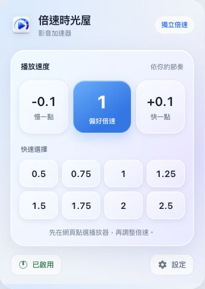

# 倍速時光屋｜影音加速器


**你的時間小偷，專門把時間偷回你口袋。**

> 每加快一秒鐘，
> 人生就多活一秒鐘。

一支影片本來要看一小時，開兩倍速，半小時就看完。時間管理大師看到你，都要先叫一聲學長。

省下半小時要幹嘛？當然是花一小時決定晚餐吃什麼。人生，就是這麼有效率又不講道理。

讓影片、線上課程與 Podcast 跟上你的節奏。看快一點、聽快一點，把時間留給你想做的事。

## 下載與安裝

目前下載版本為 **0.11.3**（`0.11.3-zh-TW.1`），與 2026-10-28 提交 Chrome Web Store 審查的版本使用相同執行檔。本次移除最詳細診斷模式的原始按鍵記錄、將本版問題回報連至本專案，並補充隱私說明；既有獨立倍速與淺色玻璃介面保留。

Chrome Web Store 已於 2026-10-28 送審，當日最後確認狀態為「待審查」。商店公開安裝入口待核准後補上，目前可使用下方 ZIP 手動安裝。

**[開啟安裝包下載頁：倍速時光屋.zip](https://github.com/94AI/speed-time-room/blob/e8208ed7eccdfa37e3e069d9524d80b186f84659/倍速時光屋.zip)**

開啟後，按檔案工具列右側的 **↓「Download raw file」** 下載 ZIP。一般安裝只需要這份安裝包。

如果舊連結出現 404，請回到本頁使用上方入口。內建瀏覽器可能把直接開啟 ZIP 的網址當成網頁；請使用下載按鈕。

下載完成後：

1. 解壓縮 ZIP，保留裡面的「倍速時光屋」資料夾。
2. 在 Chrome 開啟 `chrome://extensions`，打開右上角「開發人員模式」。
3. 按「載入未封裝項目」，選取內含 `manifest.json` 的「倍速時光屋」資料夾。
4. 停用其他倍速擴充功能，再重新整理影片或 Podcast 網頁。

需要 Chrome 114 以上。請保留載入的資料夾；Chrome 會持續從該位置讀取檔案。完整設定與更新方式見 [使用說明](README-zh-TW.md)。

## 能做什麼

- **每個播放器各調各的速度**：同頁的影片與音訊互不套用倍速，不同分頁也隔離。
- **影片與 Podcast**：控制可存取的 HTML5 video／audio 播放器。
- **自訂快捷鍵**：預設 A 降低倍數、D 提高倍速、S 重設倍速；其他按鍵也能調整。
- **macOS 風格液態玻璃**：可調背景不透明度，倍速數字放大加粗，支援深色與淺色模式。
- **淺色玻璃工具列面板**：偏好倍速預設 1.0 倍，快選與啟用狀態清楚可見。
- **繁體中文設定頁**：可預設隱藏控制器，需要時按 V 顯示／隱藏。
- **網站規則**：可指定起始倍速或在特定網站停用。

先將滑鼠移到目標播放器，或點選播放器／控制器，再使用快捷鍵。多個播放器都暫停且尚未選定目標時，不會猜測要改哪一個。



介面預覽使用實際建置後的面板與設定儲存替身；實際數值依使用者儲存的設定為準。

## 預設快捷鍵

| 動作 | 按鍵 | 預設數值 |
| --- | --- | --- |
| 降低倍數 | A | 每次降低 0.1 倍 |
| 提高倍速 | D | 每次提高 0.1 倍 |
| 重設倍速 | S | 1.0 倍；保留原有切換記憶 |
| 偏好倍速 | G | 1.0 倍 |
| 倒退／快進 | Z／X | 10 秒 |
| 顯示／隱藏控制器 | V | — |

已有儲存或匯入的快捷鍵會保留；新版預設值適用於首次安裝與還原預設值。

## 支援範圍

本專案以 [Video Speed Controller v0.11.1](https://github.com/igrigorik/videospeed/releases/tag/v0.11.1) 為基礎，改為獨立播放器速度與繁體中文介面，並加入新的控制器外觀。

使用者回報實測 Spotify 目前無法透過本擴充功能控制倍速；Spotify 音樂維持原站播放。其他服務需使用可存取且允許調速的 HTML5 media。DRM、封閉 shadow root、非 HTML5 播放管線或禁止注入的頁面，可能無法控制；Spotify 不列為目前支援的加速服務。網站建立全新播放器時，會使用網站原生速度或明確設定的網站起始倍速。

## 原始碼與開發

**[開啟原始碼下載頁：原始碼.zip](https://github.com/94AI/speed-time-room/blob/e8208ed7eccdfa37e3e069d9524d80b186f84659/原始碼.zip)**，再按檔案工具列右側的 **↓「Download raw file」** 下載。

解壓縮後進入 `speed-time-room` 資料夾。內含 0.11.3 的完整程式、546 項測試、建置設定、鎖定版本的相依套件清單與驗證紀錄，可供其他電腦或雲端環境接續開發。

## 開發與驗證

```sh
npm ci
npm test
npm run lint
npm run build
```

開發時載入 `dist/`。Node.js 版本條件見 `package.json`。實際 Chrome 擴充功能回歸腳本可用 `npm run test:e2e:private` 執行。

單元／整合測試共 44 個檔案、546 項通過，包含 2 項按鍵診斷隱私回歸測試。完整瀏覽器測試受本機執行環境限制，尚未取得通過結果；驗證細節見 [測試報告](VERIFICATION-zh-TW.md)。

## 授權與原始專案

感謝 [Ilya Grigorik 與原專案貢獻者](https://github.com/igrigorik/videospeed)。本專案是獨立修改版，並非原專案的官方發行版本，保留原作者著作權聲明與完整 [MIT License](LICENSE)。原始專案說明見 [README-UPSTREAM.md](README-UPSTREAM.md)。

公開版識別：`0.11.3-zh-TW.1`。上游基底 commit：`8f9bc13cd1d8bad549795da265735159d9e9fad1`。
